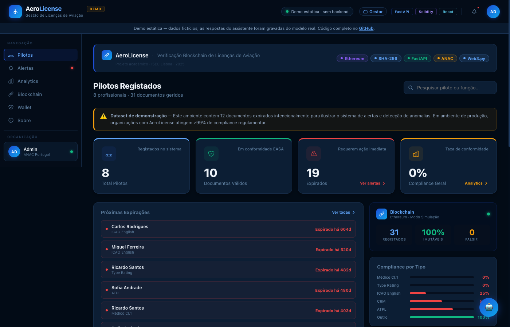
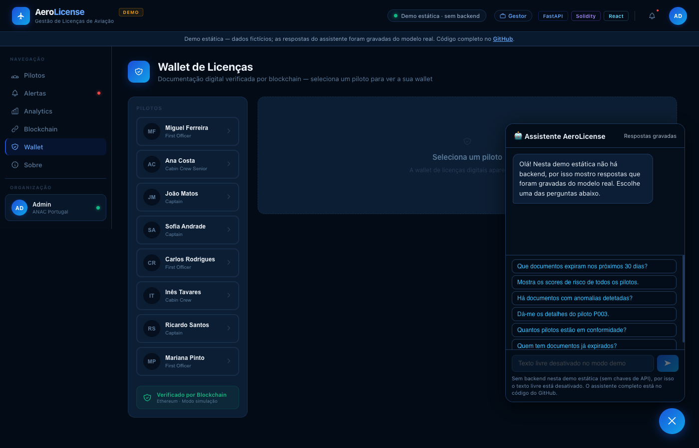
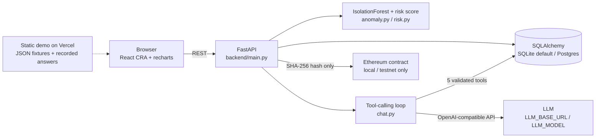

# AeroLicense

A compliance dashboard for aviation licences and medical certificates, with a tool-calling AI assistant, ML anomaly detection and SHA-256 document hashing anchored on Ethereum.

[](https://github.com/fran2002cunha-lab/aerolicense-demo/actions/workflows/ci.yml)
[](LICENSE)

**Live demo:** https://aerolicense.vercel.app

> **This is a static demo.** It has fictional data and no backend. The assistant's answers were recorded once from a real model, and uploaded files are hashed in your browser only. The UI is in Portuguese (European).

| Dashboard | AI assistant |
|---|---|
|  |  |

## The problem

Pilots and crew must hold several valid documents at once (licence, Class 1 medical, ICAO English, type rating, CRM).
Tracking expiry dates across a whole crew by hand is error-prone, and a PDF is easy to alter.
AeroLicense explores how an operator could see compliance at a glance, ask questions in plain language and check that a document has not been tampered with.

## Features

- **Compliance dashboard**: pilots, documents, expiry alerts, compliance by document type (React + recharts).
- **AI assistant**: answers questions about the data by calling 5 backend tools (OpenAI-compatible function calling).
- **Anomaly detection**: scikit-learn `IsolationForest` flags unusual documents and explains why in plain language (`backend/anomaly.py`).
- **Risk score**: a 0-100 score per pilot that combines expired documents, documents about to expire and anomalies (`backend/risk.py`).
- **Document integrity**: SHA-256 hash of each file, optionally anchored on Ethereum through a Solidity contract (`smart_contract/contracts/AeroLicenseRegistry.sol`), plus a QR code for verification.
- **Demo mode by default**: with no environment variables, the API runs on SQLite with a simulated blockchain and canned chat answers.

## Architecture



## The AI part

The assistant lives in `backend/chat.py` and is exposed by `POST /chat`.

- **Tools**: `get_pilots_summary`, `get_expiring_documents(days)`, `get_pilot_detail(pilot_id)`, `get_risk_scores`, `get_anomalies`. The model can only read data through these functions; it never sees SQL or the database.
- **Argument validation**: arguments come from the model, so they are treated as untrusted input. Each tool has a Pydantic model with `extra="forbid"` (for example `days` between 0 and 3650, `pilot_id` must match `^P\d{3}$`).
- **Errors go back to the model**: invalid JSON, unknown tools, validation errors and tool exceptions return `{"error": ...}` as the tool result, so the model can correct itself instead of the request crashing.
- **Loop cap**: at most 5 tool-call rounds per question, then a fixed fallback message.
- **Prompt-injection mitigation**: the request schema only accepts history entries with role `user` or `assistant`, and `chat.py` drops anything else, so a client cannot inject `system` or `tool` messages. The only system message is the server's own prompt. Message length and history size are capped, and `/chat` is rate limited (10 requests per minute per IP).
- **Provider-agnostic**: `LLM_BASE_URL` and `LLM_MODEL` point the client at any OpenAI-compatible provider (default model `gpt-4o-mini`).
- **Evals** (`backend/evals/`): 11 questions, each with the tool it should call and, where it matters, argument constraints. The eval reports **tool-selection accuracy** and **argument accuracy**. `--mock` swaps the model for a deterministic keyword router, so CI tests the harness and the tool plumbing without a key or network; with a real key it measures model quality. See [backend/evals/README.md](backend/evals/README.md).
- **Recorded demo answers**: `backend/scripts/record_demo_chat.py` runs a fixed list of questions through the real `run_chat` loop against a seeded temporary DB and writes `frontend/public/fixtures/chat_recordings.json` (questions, tool calls and answers only; no prompt, IDs or keys). The static demo replays those recordings. The repo ships `chat_recordings.example.json` to show the format.

## Security

The hardening came from an audit I ran on my own repo:

- `X-API-Key` required on write endpoints (`/documents/upload`, `/documents/hash`); if `AEROLICENSE_API_KEY` is unset they return 503 (fail closed).
- Uploads capped at 5 MB and checked by magic bytes (PDF, PNG, JPEG); the client's Content-Type is not trusted.
- Generic error messages to clients; details go to the server log.
- CORS from an explicit allowlist (`CORS_ORIGINS`), never `*`.
- Rate-limited `/chat` (in memory, per process; production would use Redis or a gateway).
- An open proxy endpoint was removed.
- The transaction signer only works when `BLOCKCHAIN_NETWORK` is local, hardhat, sepolia or holesky; mainnet is refused.
- Static site served with a strict Content-Security-Policy and related headers (`frontend/vercel.json`), built without source maps.

## Quickstart

Requirements: Python 3.12 (used in CI), Node.js 20.

**Backend**

```bash
cd backend
python3 -m venv venv
source venv/bin/activate
pip install -r requirements.txt
cp .env.example .env        # optional; every variable has a demo default
uvicorn main:app --reload --env-file .env
```

API at http://localhost:8000, Swagger UI at http://localhost:8000/docs. Without `OPENAI_API_KEY` the chat returns canned demo answers; without `CONTRACT_ADDRESS` blockchain writes are simulated; without `AEROLICENSE_API_KEY` write endpoints are disabled. Run without `--env-file .env` to use all the defaults.

**Frontend**

```bash
cd frontend
npm ci
npm start                   # http://localhost:3000, talks to http://localhost:8000
```

`REACT_APP_API_URL` changes the backend URL. `npm run build` produces the static demo build (`REACT_APP_DEMO=true`, fixtures instead of the API).

**Smart contract (optional)**

```bash
cd smart_contract
npm install
./setup.sh                  # starts a Hardhat node and deploys the contract
```

Put the printed address in `backend/.env` as `CONTRACT_ADDRESS`, with `BLOCKCHAIN_NETWORK=hardhat`.

**Tests and evals** (from the repo root)

```bash
backend/venv/bin/pip install pytest httpx
backend/venv/bin/python -m pytest -q
backend/venv/bin/python backend/evals/run_evals.py --mock
(cd frontend && CI=true npm test)
```

## Tests & CI

- **112 backend tests** (pytest, `tests/`): API and database, chat loop and tool validation, analytics, LLM recording and evals with a mocked client.
- **21 frontend tests** (Jest + React Testing Library).
- **GitHub Actions** (`.github/workflows/ci.yml`): installs the backend, runs pytest, runs the tool-selection eval in mock mode with `--fail-under 1.0`, and builds the frontend. CI uses no secrets and calls no external services.

## Design decisions & trade-offs

- **Only hashes go on-chain.** The file and its personal data stay off-chain; the contract stores a `bytes32` SHA-256 hash. Anyone holding the file can recompute the hash and compare it, and changing one character changes the hash. Even so, a hash on a public chain is permanent (see limitations).
- **Static demo instead of a hosted backend.** A public endpoint with an LLM key behind it costs money and invites abuse. The static build shows the real UI with fixtures and answers recorded from a real model, and the full assistant is in the code.
- **SQLite by default.** Zero setup for reviewers, and tests run on an in-memory SQLite DB. `DATABASE_URL` switches to Postgres through SQLAlchemy without code changes.
- **Readable anomaly reasons.** An IsolationForest score alone means little to an operator, so each flag comes with reasons such as "issued on a weekend" or "rare issuer".

## Limitations & why this isn't a product

My professor pointed out the issues below, and working through them was one of the most useful outcomes of the project:

- **Licences are regulated.** Pilot licences and medicals fall under EASA Part-FCL and Part-MED, issued in Portugal by the national authority (ANAC). Only the issuing authority is the source of truth; a third-party registry cannot make a document valid.
- **Medical certificates are special-category data** under GDPR Art. 9. A real system would need a DPIA and a lawful basis before processing them.
- **Public chains are permanent.** A hash written to a public chain cannot be deleted, which is in tension with the right to erasure, even if a hash is not the document itself.
- **Who runs the registry?** An airline, a training school or a vendor operating the verification registry would have a conflict of interest.
- **Synthetic data.** All pilots and documents are fictional. The project is not affiliated with any airline or aviation authority.
- The rate limiter is in memory and per process, and the anomaly model runs on a tiny synthetic dataset.

## How I used AI tools

I used AI coding assistants (Claude Code) as a pair programmer. I defined the architecture and requirements, reviewed and tested every change, and the security hardening came from an audit I ran on my own repo.

## Credits

Designed and built by Francisco Cunha as an ISEC Lisboa course project.

[github.com/fran2002cunha-lab](https://github.com/fran2002cunha-lab)

## License

[MIT](LICENSE)
